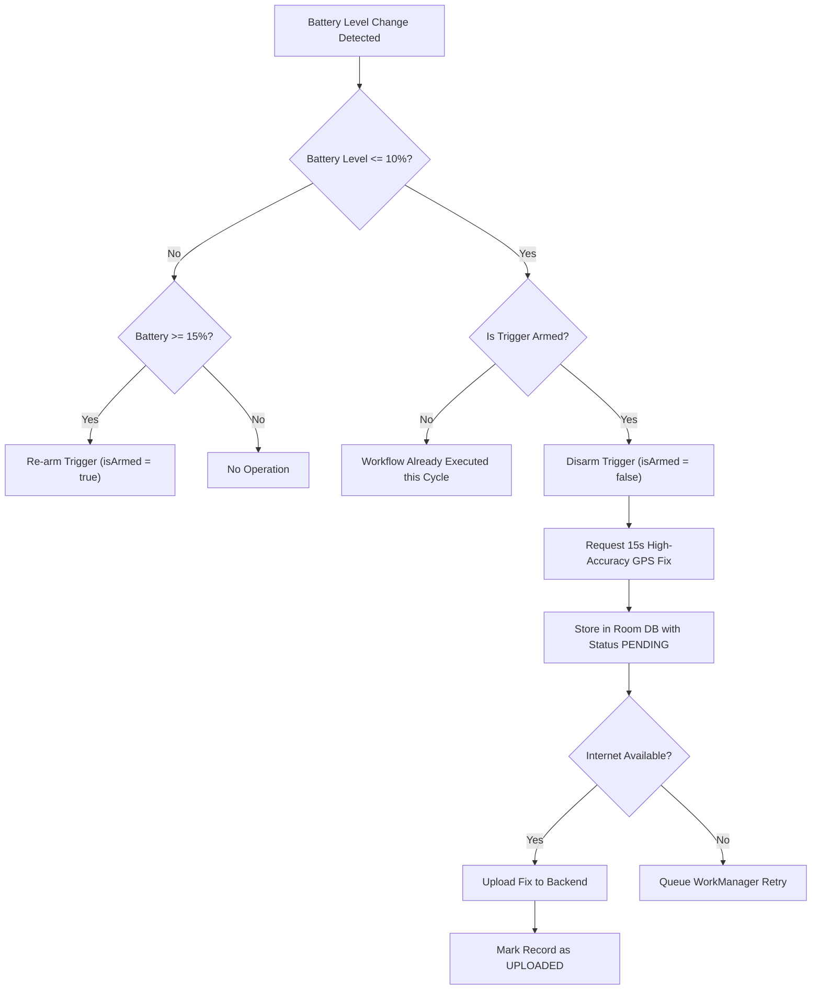

# PowerTrack Android Location Strategy & Operating System Constraints

## 1. Location Acquisition Strategy

PowerTrack utilizes Google Play services `FusedLocationProviderClient` to combine signals from GNSS (GPS, GLONASS, Galileo, BeiDou), Wi-Fi scanning, cell tower triangulation, and onboard inertial sensors.

### 1.1 Fresh Location vs Cached Location

* **Rule**: PowerTrack never relies on stale cached coordinates when an active fix is requested.
* When tracking or performing manual refresh:
  1. Requests `getCurrentLocation(Priority.PRIORITY_HIGH_ACCURACY, cancellationToken)` with a strict 15-second timeout.
  2. If a fresh fix is returned within timeout, it is marked `isFreshLocation = true`.
  3. If GPS times out or signal is lost (e.g., deep indoors), it falls back to `getLastLocation()` and explicitly marks the record as cached (`isFreshLocation = false`).
  4. The web dashboard clearly denotes cached/stale status.

### 1.2 Coordinate Integrity & Validation

Before persisting or transmitting any location, the application validates:
1. `latitude`: Must be between `-90.0` and `+90.0`. NaN or Infinite values are rejected.
2. `longitude`: Must be between `-180.0` and `+180.0`.
3. `(0.0, 0.0)` Check: Null Island coordinates caused by uninitialized GPS hardware are rejected.
4. `accuracyMeters`: Must be positive (`> 0`). The 68% horizontal accuracy radius in metres is recorded verbatim.
5. `timestamp`: Future timestamps beyond a 5-minute clock skew threshold are rejected.

---

## 2. Low-Battery Emergency Workflow (10% Trigger)

Mobile devices frequently lose power before authorized users can locate them. PowerTrack implements a dedicated low-battery capture protocol:

### Key Technical Safeguards:
- **Stateful Lock**: `isLowBatteryTriggerArmed` prevents repeating the GPS request on every battery broadcast.
- **Hysteresis Reset**: The trigger will only re-arm when the phone is charged to at least **15%**, preventing rapid toggle flapping when the battery fluctuates around 10%.
- **Local Persistence First**: The record is written to Room DB before network transmission, so an unexpected power cutoff does not delete the captured coordinate.

---

## 3. Foreground Service & Background Execution (Android 9 to 14+)

### 3.1 Foreground Service Requirement
Android severely restricts background location access for battery preservation. Standard background apps receive location updates only a few times per hour.

PowerTrack runs a **Foreground Service** with:
- `android:foregroundServiceType="location"` (Mandatory in Android 14 / API 34).
- A non-dismissible persistent notification informing the user that location tracking is running.
- Explicit notification channel: `powertrack_location_channel` (Importance: LOW, silent).

### 3.2 Battery Optimization & Doze Mode
When a phone is left stationary on a table unplugged, Android engages **Doze Mode**:
- Network access is suspended during Doze maintenance windows.
- PowerTrack's WorkManager synchronizer uses deferrable background execution with `NetworkType.CONNECTED` constraints.
- When the device moves or Doze enters a maintenance window, pending records are flushed to the cloud.

---

## 4. Hardware & Operating System Limitations (Technical Realities)

PowerTrack adheres strictly to technical accuracy and does not promise capabilities that Android hardware or kernel security prohibits:

### Limitation 1: Zero Coordinate Acquisition When Powered Off
* **Reality**: When an Android phone is completely powered off (0% battery or manual shutdown), the baseband processor, GPS chip, and Android Linux kernel are completely unpowered.
* **Alternative**: PowerTrack stores and displays the **Last Known Location** with exact timestamp, battery level, and an explicit stale warning banner. It never claims an offline phone's location is current.

### Limitation 2: Force-Stop State
* **Reality**: If a user opens Android System Settings and selects "Force Stop", Android places the package into a stopped state. In this state, Android OS drops all alarms, WorkManager tasks, and BroadcastReceivers.
* **Alternative**: The application informs the user in the Permissions & Privacy screen that force-stopping halts tracking until the application icon is tapped again.

### Limitation 3: Cold Device Reboot
* **Reality**: Upon restart, the phone does not run apps until the user unlocks the screen (Direct Boot / Credential Encrypted storage), unless components support device-encrypted storage.
* **Alternative**: PowerTrack registers `BootReceiver` listening for `ACTION_BOOT_COMPLETED` and `ACTION_MY_PACKAGE_REPLACED`. Once the phone is unlocked, if tracking was enabled before restart, the service resumes automatically.
