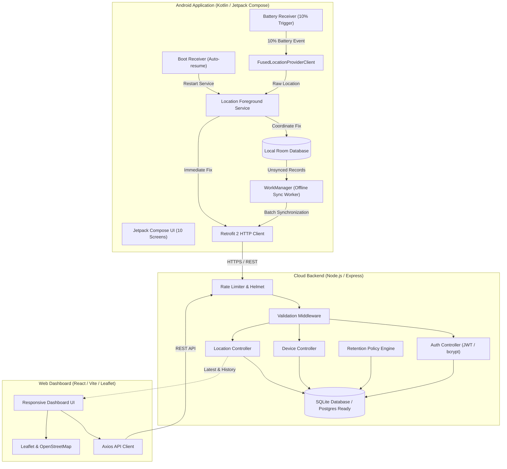
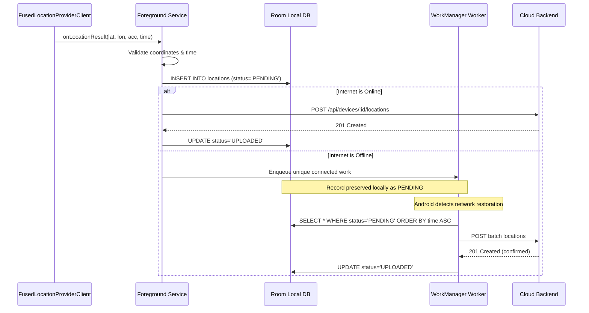

# PowerTrack Architecture & System Design Document

## 1. Overview & Core Philosophy

PowerTrack is an authorized personal mobile tracking system designed to help users locate their Android device accurately, reliably, and transparently.

### System Principles:
1. **Genuine Location Accuracy**: No fabricated coordinates, simulated tracks, or synthetic accuracy figures. Real GPS/cell/Wi-Fi fixes are reported with their true horizontal accuracy radius.
2. **Transparent Operation**: No stealth tracking or hidden surveillance. Persistent foreground notifications and explicit user consent are mandatory.
3. **Data Resilience**: Every coordinate fix is persisted locally in an on-device SQLite database (Room) with state `PENDING` before network transmission. If connectivity is lost, updates are queued and automatically uploaded via WorkManager upon network restoration.
4. **Honest Stale Status**: If a device loses signal or powers off, the system clearly marks historical coordinates as stale and never misrepresents old data as real-time.
5. **Battery Consciousness**: Tracking intervals are configurable (10s, 30s, 60s, 300s). An emergency 10% battery trigger captures a final high-accuracy fix before shutdown and disarms until recharged to 15%.

---

## 2. High-Level System Architecture

---

## 3. Database Schema

The database is built on relational SQLite and designed for transparent migration to PostgreSQL.

### `users` Table
| Column | Type | Constraints | Description |
|---|---|---|---|
| `id` | TEXT | PRIMARY KEY | User UUID |
| `email` | TEXT | UNIQUE, NOT NULL | Normalized user email |
| `password_hash` | TEXT | NOT NULL | bcrypt hash (12 salt rounds) |
| `created_at` | TEXT | NOT NULL | UTC ISO 8601 registration time |

### `devices` Table
| Column | Type | Constraints | Description |
|---|---|---|---|
| `id` | TEXT | PRIMARY KEY | Unique Device UUID |
| `user_id` | TEXT | NOT NULL, FK -> users(id) | Owning user |
| `device_name` | TEXT | NOT NULL | Display name (e.g. Pixel 8) |
| `platform` | TEXT | NOT NULL DEFAULT 'android' | Operating system |
| `registered_at` | TEXT | NOT NULL | Registration UTC ISO timestamp |
| `last_seen_at` | TEXT | NULLABLE | Heartbeat / last contact UTC timestamp |
| `last_battery_percentage` | INTEGER | NULLABLE | Latest reported battery (0–100) |
| `tracking_enabled` | INTEGER | NOT NULL DEFAULT 1 | Remote tracking toggle |

### `locations` Table
| Column | Type | Constraints | Description |
|---|---|---|---|
| `id` | INTEGER | PRIMARY KEY AUTOINCREMENT | Surrogate key |
| `event_id` | TEXT | UNIQUE, NOT NULL | Idempotency UUID from device |
| `device_id` | TEXT | NOT NULL, FK -> devices(id) | Target device |
| `latitude` | REAL | NOT NULL | Validated between -90 and +90 |
| `longitude` | REAL | NOT NULL | Validated between -180 and +180 |
| `accuracy_meters` | REAL | NOT NULL | Horizontal 68% confidence radius in metres |
| `altitude_meters` | REAL | NULLABLE | Altitude in metres above WGS 84 ellipsoid |
| `speed_meters_per_second` | REAL | NULLABLE | Ground speed |
| `bearing_degrees` | REAL | NULLABLE | Travel direction (0–360°) |
| `battery_percentage` | INTEGER | NOT NULL | Battery level at capture (0–100) |
| `recorded_at_utc` | TEXT | NOT NULL | Phone device capture timestamp |
| `received_at_utc` | TEXT | NOT NULL | Server ingestion timestamp |
| `location_source` | TEXT | NOT NULL DEFAULT 'fused' | GPS, network, fused, passive |
| `is_fresh_location` | INTEGER | NOT NULL DEFAULT 1 | 1 = Fresh GPS fix; 0 = Cached |

### Database Indexes
- `idx_users_email` on `users(email)`
- `idx_devices_user` on `devices(user_id)`
- `idx_locations_device_recorded` on `locations(device_id, recorded_at_utc DESC)`
- `idx_locations_event_id` on `locations(event_id)`

---

## 4. Device Status State Machine

The dashboard computes device statuses dynamically using strict temporal rules:

| Status | Condition | Meaning |
|---|---|---|
| **`ONLINE`** | Contact within 300s AND location within 900s | Device is communicating and transmitting fresh fixes |
| **`LOCATION STALE`** | Contact within 300s BUT location older than 900s | Device is connected (heartbeat active), but GPS is unavailable (e.g. indoors, underground) |
| **`OFFLINE`** | No contact within 300s | No heartbeat or location received within 5 minutes |
| **`UNKNOWN`** | Zero contacts and zero locations | Newly registered device that has never communicated |

---

## 5. Offline Queue & WorkManager Protocol

